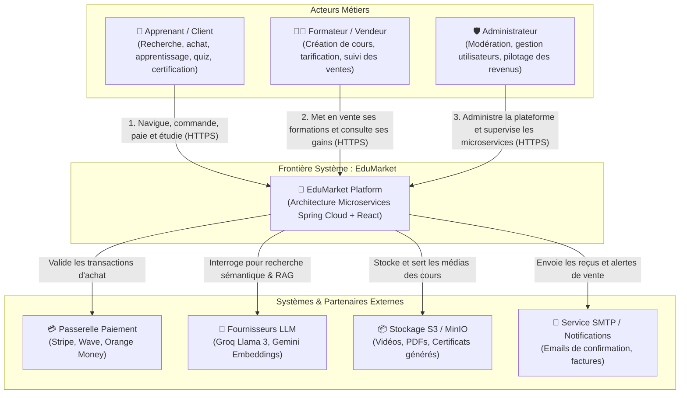

# C4 Niveau 1 : Diagramme de Contexte Système

Le diagramme de contexte système présente la frontière globale de la plateforme **EduMarket** et ses interactions avec les différents acteurs humains et systèmes externes.

## Diagramme Mermaid

## Description des Acteurs

1. **Apprenant / Client** :
   - Parcours : Découverte du catalogue -> Consultation de la fiche formation (détails, syllabus, avis, prix) -> Ajout au panier -> Paiement et confirmation -> Accès illimité au contenu pédagogique.
2. **Formateur / Vendeur (Merchant)** :
   - Parcours : Espace instructeur -> Publication d'une formation -> Définition des modules et leçons -> Fixation du prix de vente -> Suivi des métriques de vente et des inscriptions.
3. **Administrateur** :
   - Gestion des catégories de formation, validation des nouveaux formateurs, modération des contenus et supervision technique des microservices.

## Interactions avec les Systèmes Externes

- **Passerelle de Paiement** : Déclenche l'autorisation de débit et retourne un jeton de transaction pour valider la commande.
- **Fournisseurs d'IA (Groq / Google Gemini)** : Permet d'analyser le profil de l'acheteur pour lui recommander les formations les plus adaptées à ses lacunes et objectifs.
- **Stockage Objets (MinIO / AWS S3)** : Décharge les bases de données relationnelles du stockage des vidéos HD, fiches PDF et modèles de certificats.
