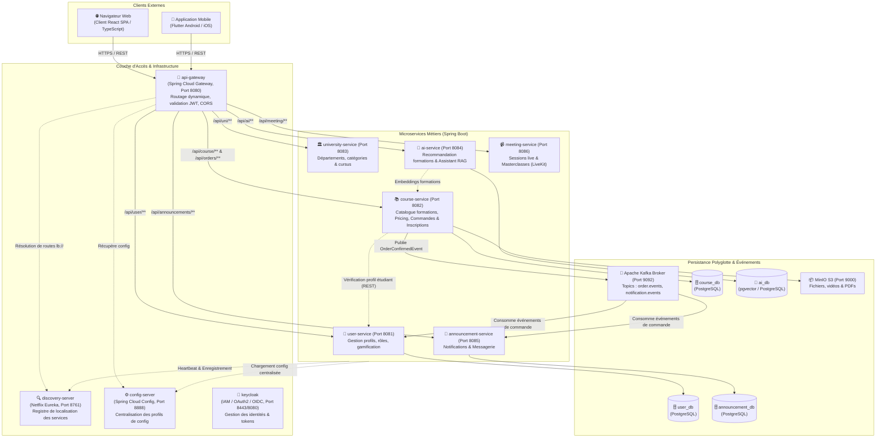

# C4 Niveau 2 : Diagramme des Conteneurs

Le diagramme des conteneurs illustre la décomposition logique et physique de la plateforme EduMarket en conteneurs autonomes (applications web, passerelle, microservices, bases de données, brokers).

## Diagramme Mermaid

## Synthèse des Conteneurs et Responsabilités

| Conteneur | Technologie | Port | Responsabilité Métier / Technique |
| :--- | :--- | :---: | :--- |
| **`lms-frontend`** | React 18, TypeScript, Tailwind | 3000 / 80 | Interface web responsive pour clients, vendeurs et admins. |
| **`api-gateway`** | Spring Cloud Gateway, WebFlux | 8080 | Point d'entrée unique, reverse proxy, validation de sécurité JWT, CORS. |
| **`discovery-server`**| Netflix Eureka | 8761 | Annuaire et découverte dynamique d'adresses d'instances. |
| **`config-server`** | Spring Cloud Config | 8888 | Distribution externalisée des fichiers de configuration versionnés. |
| **`user-service`** | Spring Boot, JPA, BCrypt | 8081 | Comptes clients, profils, niveaux, points XP et badges. |
| **`course-service`** | Spring Boot, JPA, Hibernate | 8082 | Catalogue de formations, fiches produits, pricing, panier et gestion des commandes/inscriptions. |
| **`ai-service`** | Spring Boot, Groq/Gemini, pgvector | 8084 | Moteur RAG, recommandation de cours adaptée aux lacunes des acheteurs. |
| **`announcement-service`**| Spring Boot, WebSocket | 8085 | Diffusion asynchrone des confirmations d'achats et notifications. |
| **`kafka`** | Apache Kafka (KRaft) | 9092 | Bus événementiel découplant les commandes des notifications. |
| **`postgres_db`** | PostgreSQL 16 + pgvector | 5432 | Héberge les bases logiques isolées par microservice. |
| **`minio`** | MinIO Object Storage | 9000 | Stockage objet compatible AWS S3 pour vidéos et PDFs pédagogiques. |
