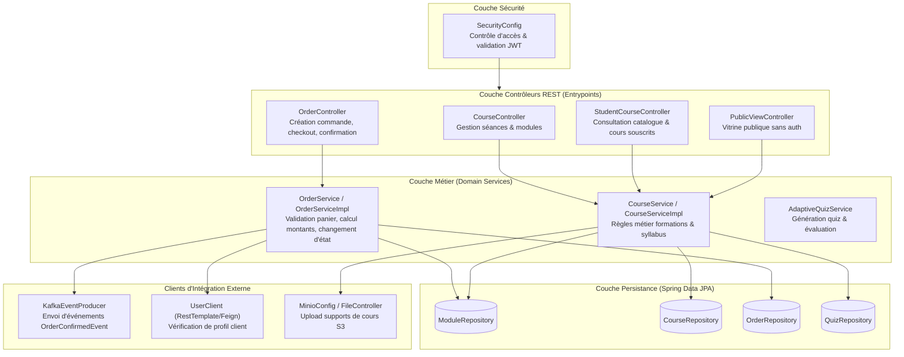

# C4 Niveau 3 : Diagramme des Composants (Focus Catalogue & Commandes)

Ce diagramme détaille la structure interne du microservice pivot `course-service`, responsable de la gestion du catalogue de formations, de la tarification et du parcours de commande / souscription.

## Organisation Interne (Clean / Layered Architecture)

## Responsabilités des Composants

1. **`OrderController` & `OrderService`** :
   - Endpoints exposés :
     - `POST /api/orders` : Validation du panier et création d'une commande à l'état `PENDING`.
     - `POST /api/orders/{id}/confirm` : Simulation de validation de paiement et bascule à l'état `PAID`.
     - `GET /api/orders/my-orders` : Liste des commandes de l'acheteur connecté.
     - `GET /api/orders/{id}` : Récupération du reçu de commande détaillé.
   - Règles métier : Vérification de la disponibilité du cours, validation du tarif, inscription automatique de l'acheteur dès confirmation, publication de l'événement Kafka.

2. **`CourseController` & `CourseService`** :
   - Gestion des fiches formations (`CModule`), chapitres (`Course`), supports multimédias (`Material`) et quiz (`Quiz`).
   - Gestion du pricing unitaire (`price`, `currency`).

3. **`KafkaEventProducer`** :
   - Publication asynchrone non-bloquante vers le topic `order.events` contenant l'ID de commande, le nom d'utilisateur de l'acheteur, le montant et le module acheté.
