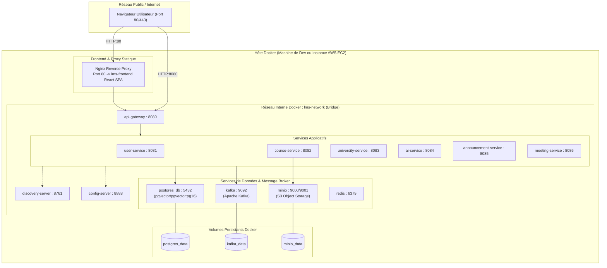

# Topologie de Déploiement : Docker Compose & Architecture Cloud

Ce document décrit la structure physique et logique du déploiement conteneurisé de la plateforme EduMarket, utilisable aussi bien sur le poste de l'évaluateur que sur un serveur cloud (AWS EC2).

## Schéma d'Architecture Réseau Docker

## Stratégie des Réseaux et des Ports

1. **Isolation Réseau** :
   - Tous les conteneurs partagent le réseau de pont `lms-network`.
   - Seuls les ports nécessaires sont exposés à l'hôte :
     - `80` : Frontend Web (Nginx).
     - `8080` : API Gateway (Entrée unique de l'API REST).
     - `8761` : Tableau de bord Netflix Eureka (Monitoring de découverte en environnement de dev).
     - `9001` : Console web MinIO (Exploration des fichiers S3).
   - Les bases de données (`5432`) et le broker Kafka (`9092`) sont accessibles depuis l'hôte en environnement local mais peuvent être restreints en production.

2. **Politique de Santé (Healthchecks)** :
   - PostgreSQL possède un healthcheck `pg_isready`.
   - `discovery-server` et `config-server` sont lancés en amont des services métiers via des directives `depends_on`.
